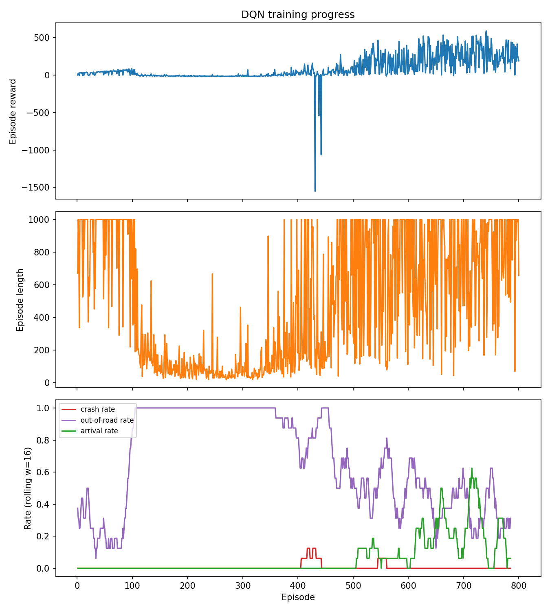

# Safe Driving with Deep Q-Networks

  <strong>Teaching an Autonomous Agent to Navigate the Road, Make Decisions, and Learn from Experience.</strong>

  A Reinforcement Learning project exploring autonomous driving through Deep Q-Networks, safety-aware reward engineering, and interactive simulation in MetaDrive.

  

---

## 🚗 From Random Actions to Intelligent Driving

What does it take for a machine to learn how to drive?

Not a collection of hardcoded rules. Not a sequence of predefined movements. Instead, an agent that observes its surroundings, makes decisions, experiences their consequences, and gradually learns a driving policy through trial and error.

This project explores that idea through **Deep Reinforcement Learning**.

We developed a Deep Q-Network (DQN) agent and trained it in the **MetaDrive** autonomous driving simulator. The agent learns to control a vehicle using a discrete action space while receiving feedback from the environment through a carefully designed reward system.

But reaching a destination is only part of the problem.

A useful driving policy must also learn to avoid collisions, remain on the road, and make decisions that lead to successful navigation.

That is where reward engineering, training stability, and meaningful evaluation become essential.

## 🎯 What We Set Out to Build

The goal was to develop an end-to-end reinforcement learning workflow for autonomous driving, covering:

- **Learning to Drive:** Training a DQN agent to make sequential driving decisions.
- **Learning from Experience:** Using replay memory and a target network to stabilize Q-learning.
- **Safety-Oriented Behavior:** Designing rewards and penalties around driving outcomes and safety events.
- **Measuring Performance:** Evaluating crashes, successful arrivals, episode lengths, and cumulative rewards.
- **Understanding the Agent:** Visualizing training progress and observing the learned policy inside the simulator.
