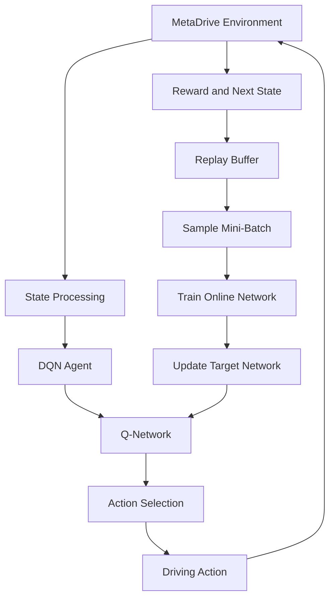

# Safe Driving with Deep Q-Networks (DQN)

**Teaching an Autonomous Vehicle to Drive Smarter, Safer, and More Reliably**

[](https://www.python.org/)
[](https://pytorch.org/)
[](https://github.com/metadriverse/metadrive)
[](https://en.wikipedia.org/wiki/Reinforcement_learning)
[](#training)

An autonomous driving agent trained using **Deep Q-Networks (DQN)** in the MetaDrive simulation environment. The project explores how an agent can learn driving behavior through interaction, reward feedback, and experience replay, with particular attention to road safety, collision avoidance, and successful navigation.

---

## Table of Contents

- [Overview](#overview)
- [Key Features](#key-features)
- [System Architecture](#system-architecture)
- [How It Works](#how-it-works)
- [Reward Design](#reward-design)
- [Training](#training)
- [Evaluation](#evaluation)
- [Installation](#installation)
- [Usage](#usage)
- [Project Structure](#project-structure)
- [Technical Challenges](#technical-challenges)
- [Technologies](#technologies)
- [Authors](#authors)
- [References](#references)

---

## Overview

Autonomous driving is a challenging sequential decision-making problem. An agent must continuously observe its environment, choose appropriate actions, and learn from the consequences of those actions.

In this project, a Deep Q-Network agent is developed and trained using **MetaDrive**, a configurable driving simulator built for autonomous driving research.

The agent learns a driving policy by interacting with the environment and optimizing its expected cumulative reward. The implementation includes experience replay, a target network, epsilon-greedy exploration, and a configurable reward function designed to encourage safer driving behavior.

The project also includes training and evaluation workflows for analyzing agent performance, tracking driving outcomes, and visualizing learned behavior.

## Key Features

- **Deep Q-Network (DQN):** Neural-network-based action-value estimation.
- **Experience Replay:** Stores and samples past transitions to improve training stability.
- **Target Network:** Uses a separate network for more stable Q-value targets.
- **Epsilon-Greedy Exploration:** Balances exploration and exploitation during training.
- **Discrete Driving Actions:** Uses a structured action space combining steering and longitudinal control.
- **Safety-Aware Reward Design:** Penalizes collisions and leaving the road while rewarding successful arrivals.
- **Reward Clipping:** Limits extreme reward values during learning.
- **GPU Support:** Supports CUDA-enabled PyTorch installations.
- **Evaluation Pipeline:** Measures driving performance and analyzes crashes and successful arrivals.
- **Visualization:** Generates training curves and supports top-down video and interactive 3D rendering.

## System Architecture

The project is organized into separate components for environment configuration, state processing, neural-network definition, experience storage, agent logic, training, and evaluation.



## How It Works

### 1. Environment Configuration

The driving environment is configured through MetaDrive. The configuration defines the simulation behavior and the reward-related settings used during training and evaluation.

Main configuration file:

`configs/env_config.py`

### 2. State Processing

The environment observations are processed before being passed to the neural network.

Main implementation:

`utils/processing.py`

### 3. DQN Network

The neural network estimates the Q-value of each available action based on the current state.

The network uses two fully connected hidden layers with 256 neurons each, followed by an output layer corresponding to the available actions.

```text
Input State
    |
Fully Connected Layer (256)
    |
Activation
    |
Fully Connected Layer (256)
    |
Activation
    |
Output Layer (10 Q-values)
```

Implementation:

`models/dqn_network.py`

### 4. Action Space

The agent operates with a discrete action space containing 10 possible actions.

The actions combine five steering levels with two longitudinal control choices:

| Steering | Longitudinal Control |
|---|---|
| Hard Left | Brake / Forward |
| Slight Left | Brake / Forward |
| Straight | Brake / Forward |
| Slight Right | Brake / Forward |
| Hard Right | Brake / Forward |

This discretization allows the DQN agent to learn driving decisions using a finite set of actions.

### 5. Experience Replay

The replay buffer stores previously observed transitions:

- Current state
- Selected action
- Reward
- Next state
- Terminal status

During training, random mini-batches are sampled from the buffer to reduce correlations between consecutive experiences.

Implementation:

`replay_buffer.py`

### 6. DQN Agent

The agent is responsible for action selection, experience collection, and network optimization.

Its implementation includes:

- Epsilon-greedy action selection
- Q-value estimation
- Experience replay
- Target-network synchronization
- Gradient-based optimization

Implementation:

`dqn_agent.py`

### 7. Q-Learning Update

The DQN agent learns by minimizing the difference between its predicted Q-values and the target Q-values.

The target is calculated using:

\[
y = r + \gamma (1-d)\max_{a'}Q_{\text{target}}(s',a')
\]

Where:

- \(r\): Immediate reward
- \(\gamma\): Discount factor
- \(d\): Terminal-state indicator
- \(s'\): Next state
- \(Q_{\text{target}}\): Target network

The optimization process updates the online network while the target network is periodically synchronized.

---

## Reward Design

Reward engineering is an important part of autonomous driving because the agent must learn to make progress without compromising safety.

The project includes a configurable reward system that considers driving outcomes and safety-related events.

The safety-aware configuration includes:

| Reward Component | Configuration |
|---|---:|
| Lateral reward | Enabled |
| Out-of-road penalty | 50 |
| Vehicle collision penalty | 50 |
| Object collision penalty | 50 |
| Speed reward | 0 |
| Successful arrival reward | 50 |
| Reward clipping | [-10, 50] |
| Episode horizon | 2000 |

The reward function is designed to:

- Penalize leaving the drivable road.
- Discourage collisions with vehicles and objects.
- Reward reaching the destination.
- Avoid relying on speed reward as a direct optimization objective.
- Keep reward values within a controlled range.

The training script also provides a legacy reward option for reproducing the earlier reward configuration.

---

## Training

The agent is trained by repeatedly interacting with the MetaDrive environment.

During each episode, the agent observes the current state, selects an action, receives a reward, and stores the resulting transition in its replay buffer.

The training process uses:

| Parameter | Value |
|---|---:|
| Hidden layer size | 256 |
| Discount factor (γ) | 0.99 |
| Learning rate | 0.001 |
| Epsilon decay | 0.995 |
| Target update frequency | 1000 |
| Action space size | 10 |

The agent supports automatic device selection and explicit CPU/GPU configuration.

### Reference Training Run

One recorded training run produced the following results:

| Metric | Result |
|---|---:|
| Training episodes | 800 |
| Total training time | 27.9 minutes |
| Average time per episode | 2.09 seconds |
| Mean reward (last 10 episodes) | 91.13 |
| Mean episode length (last 10 episodes) | 83.7 |

**Important:** These figures belong to an earlier reward configuration and should not be interpreted as evaluation results for the final safety-aware configuration.

The project also tracks reward trends, episode lengths, and driving outcomes to help analyze how the learned policy changes throughout training.

### Training Curves


---

## Evaluation

The evaluation workflow provides tools for analyzing the trained agent independently of the training process.

Available evaluation features include:

- Greedy policy evaluation.
- Average episode reward.
- Average episode length.
- Crash-rate measurement.
- Successful-arrival rate.
- Training-curve visualization.
- Top-down driving video generation.
- Interactive 3D simulation rendering.

Evaluation can be performed over multiple episodes to obtain a broader picture of the agent's behavior.

The evaluation script is implemented in:

`evaluate.py`

---

## Installation

### Prerequisites

- Python 3.10 or newer
- pip
- An NVIDIA GPU and a compatible driver for CUDA acceleration (optional)

### 1. Clone the Repository

```bash
git clone https://github.com/VahhabBM/safe-driving-dqn.git
cd safe-driving-dqn
```

### 2. Create a Virtual Environment

```bash
python -m venv .venv
```

Activate it:

**Windows:**

```bash
.venv\Scripts\activate
```

**Linux / macOS:**

```bash
source .venv/bin/activate
```

### 3. Install Non-PyTorch Dependencies

The project uses MetaDrive Simulator 0.4.3 and the following supporting libraries.

Install them first:

```bash
pip install metadrive-simulator==0.4.3 numpy matplotlib imageio imageio-ffmpeg
```

### 4. Install PyTorch Separately

**PyTorch is intentionally not version-pinned in `requirements.txt` and should be installed separately.**

A generic `pip install torch` command may install a CPU-only build depending on your platform and package index configuration.

Choose the installation command that matches your hardware and CUDA requirements.

**For CUDA 12.1:**

```bash
pip install torch --index-url https://download.pytorch.org/whl/cu121
```

**For CUDA 11.8:**

```bash
pip install torch --index-url https://download.pytorch.org/whl/cu118
```

For other configurations, consult the official PyTorch installation selector:

https://pytorch.org/get-started/locally/

### 5. Verify PyTorch Installation

Before starting GPU training, verify that PyTorch can access CUDA:

```bash
python -c "import torch; print(torch.__version__, torch.cuda.is_available())"
```

For a CUDA-enabled setup, the output should report:

```text
True
```

If it reports `False`, PyTorch may have been installed as a CPU-only build, the NVIDIA driver may be missing or outdated, or CUDA may not be available on the machine.

### CPU-Only Installation

If you do not have an NVIDIA GPU or prefer CPU execution, install PyTorch using the standard command:

```bash
pip install torch
```

You can skip the CUDA-specific installation and verification steps.

**Note:** GPU acceleration applies to PyTorch model computations. MetaDrive's simulation physics and scenario generation may remain CPU-bound, so overall training speed does not necessarily scale with GPU performance.

---

## Usage

### Training

Run a quick smoke test:

```bash
python -m train --smoke-test
```

Train the agent for 800 episodes:

```bash
python -m train --episodes 800
```

To explicitly select the execution device:

```bash
python -m train --episodes 800 --device cuda
```

Or use CPU:

```bash
python -m train --episodes 800 --device cpu
```

To reproduce the earlier reward configuration:

```bash
python -m train --episodes 800 --legacy-reward
```

### Evaluation

Evaluate the trained agent over 20 episodes:

```bash
python -m evaluate --eval-episodes 20
```

### Visualization

Generate training plots:

```bash
python -m evaluate --plot-only
```

Generate a top-down driving video:

```bash
python -m evaluate --topdown-video
```

Launch interactive 3D visualization:

```bash
python -m evaluate --show-3d
```

Run evaluation with visualization options together:

```bash
python -m evaluate --eval-episodes 20 --topdown-video --show-3d
```

For the complete list of supported arguments, use:

```bash
python -m train --help
python -m evaluate --help
```

---

## Project Structure

```text
safe-driving-dqn/
│
├── README.md
├── requirements.txt
│
├── train.py
├── evaluate.py
├── replay_buffer.py
├── dqn_agent.py
│
├── configs/
│   ├── __init__.py
│   └── env_config.py
│
├── utils/
│   ├── __init__.py
│   └── processing.py
│
├── models/
│   ├── __init__.py
│   ├── dqn_network.py
│   ├── dqn_trained.pt
│   ├── training_history.json
│   └── training_curves.png
│
└── tests/
    ├── __init__.py
    ├── test_tasks_1_2_3.py
    ├── test_tasks_4_5.py
    └── test_tasks_6_7.py
```

---

## Technical Challenges

Developing a reinforcement-learning agent for autonomous driving involves several practical challenges.

### Action-Space Design

Continuous driving controls must be represented using a discrete action space suitable for standard DQN.

### Reward Engineering

The reward function must balance successful navigation with safety-related behavior. Poorly designed rewards can encourage undesirable driving strategies.

### Training Stability

Experience replay, target-network synchronization, and controlled exploration help address instability during Q-learning.

### Safety and Performance Analysis

A high cumulative reward alone does not guarantee safe driving. Crash rates, successful arrivals, and episode lengths provide additional information about the learned policy.

### Hardware and Environment Setup

MetaDrive, PyTorch, CUDA, and GPU drivers must be configured consistently. In particular, installing the wrong PyTorch build can silently prevent GPU acceleration.

---

## Technologies

| Technology | Purpose |
|---|---|
| Python | Core implementation |
| PyTorch | Deep learning and DQN |
| MetaDrive Simulator 0.4.3 | Autonomous driving environment |
| NumPy | Numerical operations |
| Matplotlib | Training visualization |
| ImageIO | Video and image processing |
| ImageIO-FFmpeg | Video encoding support |

---

## Authors

**Vahhab Balandomanesh**

**Mohammadmahdi Kazemi**

---

## References

- [MetaDrive Simulator](https://github.com/metadriverse/metadrive)
- [PyTorch Documentation](https://pytorch.org/docs/stable/index.html)
- [Playing Atari with Deep Reinforcement Learning](https://arxiv.org/abs/1312.5602)
- [Deep Q-Learning](https://en.wikipedia.org/wiki/Q-learning)

---

*Learning to drive is not just about moving forward. It is about knowing how to get there safely.*
